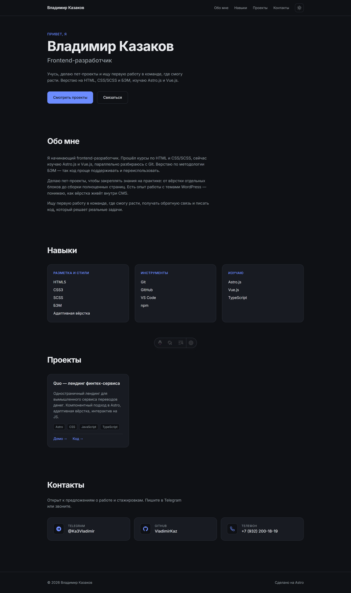

# Владимир Казаков — Frontend-разработчик



Персональный сайт-визитка и портфолио. Создан для демонстрации навыков, пет-проектов и поиска первой работы в сфере frontend-разработки.

## 🚀 Стек технологий

- **Фреймворк:** [Astro](https://astro.build/) (Zero-JS по умолчанию, Islands Architecture)
- **Язык:** TypeScript (Strict mode)
- **Стили:** Чистый CSS (CSS Variables, BEM-нейминг, слоистая архитектура)
- **Шрифты:** [Fontsource](https://fontsource.org/) (Inter Variable, JetBrains Mono)
- **Контент:** Astro Content Collections (Markdown)

## ✨ Реализованные фичи

- 🌓 Переключатель светлой и тёмной темы (с сохранением в `localStorage` и без FOUC)
- 📱 Полностью адаптивная вёрстка (mobile-first)
- 📂 Управление проектами через Content Collections (добавление нового проекта = создание `.md` файла)
- 🔍 Базовое SEO (мета-теги, Open Graph, автоматический Sitemap)
- ♿ Семантическая разметка и базовые правила доступности (a11y)

## 🛠 Локальный запуск

Убедитесь, что у вас установлен [Node.js](https://nodejs.org/) (версия 18 или выше).

```bash
# 1. Клонировать репозиторий
git clone https://github.com/VladimirKaz/my-portfolio.git

# 2. Перейти в папку проекта
cd my-portfolio

# 3. Установить зависимости
npm install

# 4. Запустить локальный сервер разработки
npm run dev
```
